# Dr. David Panman

A voice-only conversation with a full-screen, locally packaged 3D character.
OpenAI supplies inference, embeddings, transcription and speech; Chroma and the
source documents remain local. The application is intentionally network-dependent.
The original repository model is retained: its asset identity is Debbie Grayson,
not a visual likeness of a male doctor. A matching replacement asset is not supplied.

## Install and start (Windows PowerShell)

Use Python 3.12. From the repository root:

```powershell
python -m venv .venv
.\.venv\Scripts\python.exe -m pip install -r backend/requirements.txt
# Inject OPENAI_API_KEY using your deployment secret manager/process environment.
.\.venv\Scripts\python.exe backend/train_engine.py
# Required when migrating an existing index; validates labelled recall before activation:
.\.venv\Scripts\python.exe backend/train_engine.py --promote-candidate
.\.venv\Scripts\python.exe backend/main.py
```

Open http://127.0.0.1:8000. The exact application startup command is
`.\.venv\Scripts\python.exe backend/main.py`. There is one server and no Streamlit,
Ollama, local speech model download, GPU requirement or mandatory `.env` file.
For a fresh empty index, the first complete build activates automatically; do not
run promotion unless a candidate exists. Put documents in `backend/raw_data_files`.
Install Tesseract with English/Hindi language packs for OCR and LibreOffice for
legacy Office formats. Configure intentionally text-only installations by setting
`OCR_ENABLED=False` before building. Never disable the promotion gate to mask failures.

On Linux use `python3 -m venv .venv`, `.venv/bin/python -m pip install -r
backend/requirements.txt`, and `.venv/bin/python backend/main.py`. Python config
resolves paths relative to the repository, not the launch directory.

All settings are in `backend/config.py`. Set `PANMAN_DISPLAY_NAME` to confirm the
surname without changing code, and `PANMAN_DATA_ROOT` to relocate persistent data.
Set `OPENAI_API_KEY` exclusively in the server environment; never paste it into
browser code or committed configuration. `/ready` checks key presence, index and
assets without spending credits; it does not verify provider authentication.

## Index migration

Back up `backend/vector_db` before deployment. Run the indexer with the new config.
The existing ingestion manifest stages a different collection for the OpenAI
embedding profile. The active old collection is untouched and is refused by the
new query service until promotion. `--promote-candidate` validates dimensions,
source completeness and recall against `backend/evals/golden_local.jsonl` before
atomically changing the manifest. Replace that labelled set with questions and
expected sources appropriate to your documents. A previous collection is retained.
Only one indexing process should run at a time. Query the promoted index after
completion; do not concurrently update an active index while serving production.

Unchanged files are skipped. A SQLite cache keyed by provider/model/dimensions/
normalization/content hash also preserves embeddings for unchanged chunk text in
changed files. New or changed chunks alone call the embedding API, in batches.
Index metadata includes page, source, document version and indexing version.
Separate versioned source files retain multiple editions. Replacing a file in place
updates that source; use distinct filenames to retain historical editions.

## Conversation and API calls

```mermaid
flowchart LR
  Mic[Microphone + local silence detection] --> WS[Session WebSocket / request ID]
  WS --> STT[OpenAI file transcription]
  STT --> Router[Rule-based intent router]
  Router --> Emb[Optional OpenAI query embedding / cache]
  Router --> Web[Optional Brave web search]
  Emb --> DB[Local Chroma + lexical search + version filter]
  DB --> Gate[Deterministic evidence gate]
  Web --> LLM
  Gate --> LLM[One streamed OpenAI Responses request]
  LLM --> Buffer[Bounded sentence queue]
  Buffer --> TTS[OpenAI Speech API]
  TTS --> Audio[Ordered browser playback]
  Audio --> Rig[Original 3D rig / amplitude-driven jaw]
  Mic -. interruption / cancel .-> WS
  Mic -. immediate stop .-> Audio
```



A normal turn uses **1 transcription + 0 or 1 embedding + 0 or 1 web search + 1 generation + N speech
requests**, where N is the number of sentence groups. That is 3+N calls on a cache
miss, 2+N on a cache hit. General conversation uses 0 embeddings and 0 web calls.
Current information uses Brave search when `BRAVE_SEARCH_API_KEY` is set and
`WEB_SEARCH_ENABLED` is true. Search failure or missing credentials are passed to
the answer prompt as unavailable; the assistant must not invent current facts.
No model query rewriting, classification, per-passage calls or semantic validation
calls are used. Requests stream into a bounded sentence queue. The answer synthesis
worker and optional conversational cues feed one ordered audio sequence with playback acknowledgements and bounded lookahead.
WAV bytes stream from OpenAI into each segment; playback begins when that segment
is complete, while later sentences are being synthesized.

Short, intent-aware cues may acknowledge slower questions, and one stage-based progress line may follow during a long wait. Fast answers skip these cues. The browser shows the current processing stage immediately. See [conversational behaviour](docs/CONVERSATIONAL_BEHAVIOUR.md) for timing, configuration and validation.

The microphone is the only input control. One click grants capture; silence ends
the utterance. After speech, the button is ready for the next turn. While the
assistant speaks, echo-cancelled microphone activity can interrupt automatically;
clicking also interrupts. Request IDs, cancellation and browser epochs discard stale
output. Failed TTS retains response text and retries remaining speech on a microphone
click, without another LLM request. Session history is memory-only and bounded;
a page reload or connection loss starts a fresh isolated session.

## Models and voice

Defaults are `gpt-5.4-mini`, `text-embedding-3-small` (1536 dimensions),
`gpt-transcribe`, and `gpt-4o-mini-tts` with `onyx` and British delivery instructions.
The small chat/embedding models keep routine grounded conversations economical;
transcription uses the current documented file endpoint. These are configurable,
not claims of measured latency, cost or account access.

**Speech API migration deadline:** official documentation schedules the Speech API
TTS models to shut down on **January 6, 2027**. Its documented replacement uses
Realtime; it cannot be adopted by merely replacing the speech model string.
See [OpenAI Speech documentation](https://developers.openai.com/api/docs/guides/text-to-speech),
[transcription](https://developers.openai.com/api/docs/guides/speech-to-text),
[chat model](https://developers.openai.com/api/docs/models/gpt-5.4-mini), and
[embeddings](https://developers.openai.com/api/docs/guides/embeddings).

Onyx is the default voice, with instructions for a mature Southern British
professor speaking at a normal conversational pace. `voice-audition/onyx-british-mature.wav`
is an earlier fixed audition sample; new replies use the current instructions.
Voice and accent are subjective; audition the output before using it with an audience.
Set `OPENAI_TTS_VOICE` to another built-in voice if preferred. For an approved
recorded custom voice, set `OPENAI_TTS_CUSTOM_VOICE_ID` to its voice ID; it takes
precedence over `OPENAI_TTS_VOICE`. Custom voice creation requires an eligible
OpenAI account and a consent recording from the speaker. `backend/scripts/validate_voice.py`
creates samples only when explicitly run.

## Diagnostics, tests and deployment

Metadata-only `panman.usage` server logs report service, model, request ID, request
count, reported token/audio usage, latency, retry count and errors. No prompts,
transcripts, API keys or provider error bodies are logged. Speech exposes output
bytes but not token usage through this binary response. Missing usage stays unknown.
Retries are disabled; ambiguous failures are not automatically charged again.
Optional `API_PRICING` entries may estimate token expenditure from actual reported
usage; pricing is never guessed and audio byte counts are never treated as tokens.
Keep diagnostics in operator logs, outside the user interface.

```powershell
.\.venv\Scripts\python.exe -m pip install -r requirements-dev.txt
.\.venv\Scripts\python.exe -m pytest -q
# With the application running and Microsoft Edge installed:
.\.venv\Scripts\python.exe tests/browser_smoke.py
```

The browser test uses real Edge/WebGL with synthetic microphone samples and mocked
remote speech. It does not validate the live provider, real microphone acoustics,
British accent or hardware echo cancellation. Browser screenshots are under
`tests/artifacts`. The model has no morph targets: jaw animation follows amplitude,
not phonemes. Browser microphone access requires localhost or HTTPS. Headphones
improve barge-in reliability; tune the central RMS/silence thresholds for the room.

Docker: `docker compose build`, `docker compose run --rm app python backend/train_engine.py`,
then promote if needed and `docker compose up -d`. Set `OPENAI_API_KEY` in the shell
before Compose. Persistent source/vector directories are mounted; GPU services are
removed. Use one ASGI worker. The supplied Caddyfile is a reverse-proxy template;
configure HTTPS and deployment authentication before exposing a paid API publicly.
The application is bound to loopback by default. No production authentication or
multi-worker shared session store is included.

Historical root-level reports and JSON evaluation results describe the old product;
this README and MIGRATION.md supersede their installation instructions.

## Asset attribution

The retained character is [Invincible - Debbie Grayson](https://sketchfab.com/3d-models/invincible-debbie-grayson-ee506a1b4f754694892a33b8d0f65344)
by [ASideOfChidori](https://sketchfab.com/asideofchidori), licensed
[CC BY 4.0](https://creativecommons.org/licenses/by/4.0/).
The bundled model and Three.js licence files remain with the assets.
